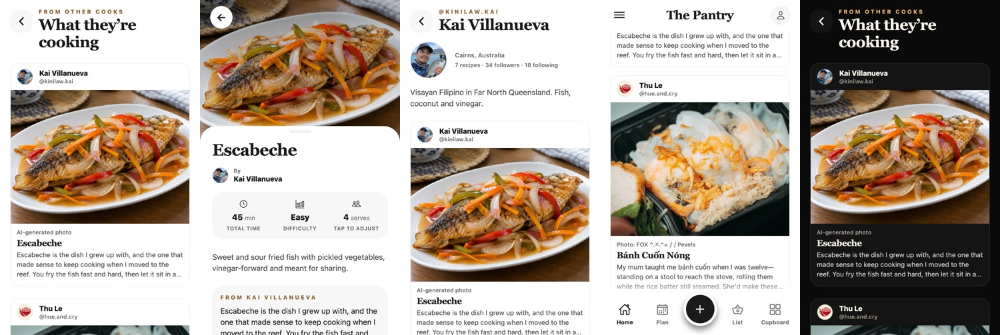

# cloud/12-feed: other cooks' recipes in the feed (read only)

Branch `cloud/12-feed`, from `preview-2026-10-08`. Not merged anywhere.

## What it does

The 592 published recipes in `public.published_recipes` now show in the app, read only.

- **Home (v1's Feed tab, D-027: "posts join below it")**: a "From other cooks · What they're cooking" section near the bottom of Home, showing the newest 3, with **See more from other cooks**. It hides itself if nothing is published, and shows a retry if the server can't be reached. Home's own picks are unaffected.
- **`/feed`**: the full feed, newest first, 12 at a time. The next page loads as you near the end. It has pull to refresh, loading, error-with-retry, empty and "That's everything for now" states. Each card shows the cook (avatar, name, @handle), the photo, the **photo credit**, the title and the caption (3 lines).
- **`/feed/[id]`**: the recipe page. It uses the same header, ingredients, method and notes components as catalogue recipes. The `recipe` jsonb is mapped onto the page model (`PublishedRecipe` = `Recipe` without source, provenance and image, keeping the cook's cuisine word). It shows the cook's caption ("From Kai…"), "Published by @handle" and the photo credit. Servings and units still adjust. Tapping the byline opens the cook.
- **`/cooks/[id]`**: the cook's profile. It shows their avatar, name, @handle, region, bio, the counts as the database keeps them (recipes · followers · following) and their recipes, paged the same way.

## How it's built

- `src/domain/published/published.ts` is pure. It checks every row before a screen sees it, and a bad row is dropped. It also holds the keyset cursor (`published_at desc, id desc`), the filter builder (it checks the timestamp and uuid first, so a row can't change the query) and the storage URL builder (own-project paths only, plan rule 5). It also builds the credit line: AI photos always say "AI-generated", per D-029.
- `src/lib/published.ts` is the read-only query layer (select only). It uses the existing `supabase()` client with the publishable key, sets a 15 s timeout on every call, and returns results instead of throwing. It **never signs in**: anon can read, so looking at the feed doesn't create an anonymous account.
- `src/lib/usePublished.ts` holds the screen state (`useRead`, `useFeed`), following the plan's rules 3 and 12. Lists are FlatLists.
- `RecipeHeader` and `Ingredients` gained optional actions and an optional `author`, so the catalogue page is unchanged. `Avatar` can now show a photo.
- **Checked live (read only):** all 592 rows page through with no repeats or drops, all 592 recipe jsonb parse with no lost ingredient lines, and all 100 cooks parse. Screenshots are from the web build against the live project.

## Tests

- `npm run typecheck`, `npm run lint` and `npm run format:check` are clean.
- `npm test`: domain 351/351, Jest 34 suites, 131/131. That includes the new `published.test.ts` (parsing, credits, cursor, filter safety, storage URLs), `lib/published.test.tsx` (the query shape: published only, newest first, page size, cursor, error mapping), `CommunityFeed.test.tsx` (feed, paging once, errors, empty, Home section, cook profile) and `PublishedRecipeScreen.test.tsx`. All use mocked rows (`src/domain/testing/published.ts`).
- Not done: simulator, Maestro, or a phone run.

## Schema note

`published_recipes`, `cooks` and `follows` **are not in `supabase/migrations/`**. They were made directly on the live project. The typed read layer above is the only definition in the repo. Before P9 builds on them, they should be captured as a migration, so PGlite tests can cover their RLS. Nothing was written to or migrated on the live project.

Live RLS, as read: `anyone reads published recipes` (anon and authenticated, `status = 'published'`), `anyone reads cooks` (true) and `anyone reads follows` (true). Buckets `recipe-photos` and `avatars` are public.

## Needs Lachlan

1. **`cooks.user_id` is readable by anyone** (the policy is `select … true` over every column). That ties each public profile to an auth user id. The app doesn't request it. Recommend a view or column grant that leaves it out before real users publish.
2. **Three server cuisines aren't in the catalogue**: caribbean, east-african and pacific-islands. They show fine (the page only uses cuisine for the empty-photo tint). Decide whether Browse should gain them.
3. **Read-only by choice.** Save, Plan, Cook Mode and Add to list are hidden on published recipes, because they work on this phone's recipe book and these recipes aren't in it. Making them work means deciding how a remote recipe is kept (copy into the book, or reference by id). Likes, comments and follows wait for P9 moderation (rule 6).
4. Photos are full-size PNGs and JPGs (around 1.6 MB each) straight from public storage. Fine for testing. Before launch, use Supabase image transforms or upload smaller renditions (PERF-17).
5. TanStack Query (plan rule 3) isn't added. This uses the repo's existing result-returning pattern, so no new package was needed. Swap it in when P9 adds it.
